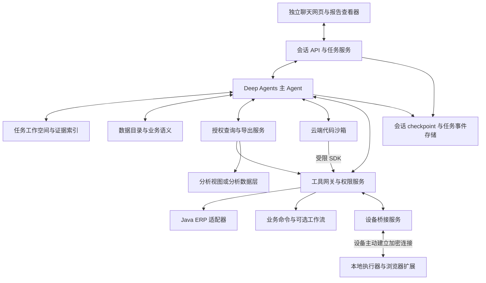

# 基于 Deep Agents 的纺织工厂 Agent 架构

版本：0.1。日期：2026 年 11 月 3 日。状态：设计方案。

采用自托管 Deep Agents SDK 构建自主 Agent 主体。用户通过独立网页提出需求，Agent 在授权范围内发现数据、调整研究计划、调用工具、编写和运行分析代码，验证结果后交付报告或执行业务操作。工作流是可调用的业务能力，研究路径由 Agent 根据观察动态决定。

本文中的产品模块、接口名称和运行协议是拟建设的设计，不代表 Deep Agents 自带这些企业能力。框架能力以引用的官方文档为依据；开发前应锁定依赖版本并完成兼容性验证。

## 1 产品目标与设计边界

核心用户体验是：面对未预设的问题，Agent 仍能利用已有数据和工具组合出解决办法。例如：

> 找出最近三个月销售增长但考虑返工、委外和回款后价值下降的面料，结合电商竞品提出下一季度产品建议，并列出可以创建的打样任务。

系统无需预先拥有这个问题的报表模板。它需要能够寻找销售、生产、质量、成本、回款和竞品数据，确认计算口径，执行多轮分析，记录证据和限制。创建打样任务则通过现有业务权限及业务接口完成。

设计遵守以下边界：

- 自主性体现在选择研究路径、组合工具、创建临时指标、编写代码和修正假设。
- 权限由服务端、数据服务、沙箱和设备执行层落实，不能通过提示词、生成代码或子 Agent 获得额外权限。
- 业务真实性来自数据与证据。没有历史快照、实际成本或可比商品规格时，允许交付部分结果并明确不足。
- 有源码和 API 的 ERP 优先通过接口接入；浏览器主要用于登录态采集和没有合适接口的局部操作。
- 本地执行不等于本地模型。默认模型调用与主 Harness 在云端，本地只承担需要当地资源的工作。
- 不承诺一开始覆盖 ERP 全部功能。功能覆盖按读、分析、写、审批、附件和设备操作逐步验收。

## 2 架构决策

| 决策 | 选择 | 原因 |
| --- | --- | --- |
| Agent 主体 | Python Deep Agents SDK，自托管 | 复用成熟 Harness，保留模型和执行环境选择权 |
| 控制方式 | 自主工具循环，动态研究计划 | 支持开发者没有预设过的问题 |
| 分析能力 | 数据目录、授权查询、代码沙箱、文件产物 | 自由组合数据和计算，避免固定报表能力上限 |
| ERP 接入 | Java API 适配层，补充分析数据通道 | 沿用业务校验，同时支持跨模块探索 |
| 云端与本地 | 一个主会话，多个受控执行环境 | 保留 SaaS 入口和本地登录环境 |
| 插件化 | 内部版本化插件契约，先做两个真实适配器验证 | 降低后续接入成本，避免过早设计市场 |
| 持久化 | Agent checkpoint、任务事件、文件清单分别持久化 | 会话状态、业务副作用、文件状态各自可恢复 |
| 固定工作流 | 作为业务工具按需调用 | 处理审批和跨服务业务，不限制研究路径 |

Deep Agents 官方提供规划、文件系统上下文、工具、子 Agent 和记忆等扩展点；这些机制构成主体 Harness 的基础。[Deep Agents 概览](https://docs.langchain.com/oss/python/deepagents/overview)

## 3 总体架构



主 Agent 默认直接处理任务。只有大规模页面采集、可独立验证的并行调查、上下文很大的专项分析，才考虑子 Agent。子 Agent 返回结论、数据引用、代码引用、证据和限制；主 Agent仍需检查结果。子 Agent 的权限只能是父任务权限的子集。

## 4 技术栈与部署单元

| 层 | 初始选择 | 边界 |
| --- | --- | --- |
| 网页 | React、TypeScript，Next.js 可选 | 聊天、流式过程、审批卡片、报告与附件 |
| Agent API | Python、FastAPI | 登录身份映射、会话操作、任务启动和恢复 |
| Agent Runtime | Deep Agents、LangGraph 持久化组件 | Agent 循环、上下文、工具、暂停与恢复 |
| 分析沙箱 | 隔离容器或微虚拟机；Python、DuckDB、Polars 或 pandas | 临时分析、图表、文件，不持有生产管理员凭据 |
| ERP 连接器 | Java、Spring Boot，复用原有微服务 | 字段映射、业务命令、幂等和结果核对 |
| 主数据库 | PostgreSQL | 租户、任务、checkpoint、事件、工具版本和审计 |
| 产物存储 | S3 兼容对象存储 | Parquet、截图、报告、脚本和文件清单 |
| 设备桥接 | 服务端连接网关；本地 Node.js 和 TypeScript | 设备注册、任务租约、浏览器能力和断线恢复 |
| 浏览器 | Chrome 或 Edge 扩展，或独立 Playwright 浏览器 | 按平台、操作系统和客户环境验证 |
| 观测 | OpenTelemetry；LangSmith 可选 | 跟踪任务、模型和工具；上报前执行脱敏与留存策略 |

初期 Agent API、目录和网关可作为一个模块化服务部署，沙箱和本地执行器必须单独隔离。Redis、消息中间件、分析仓库和 Temporal 按规模及可靠性需求加入，不作为首个原型的强制依赖。现有 ERP 使用 Java 不要求 Agent Runtime 也使用 Java。

容器不能只靠路径限制实现多租户隔离。生产沙箱需要独立身份、受限挂载、进程权限、CPU/内存/时长限制、受控网络出口和清理策略；根据运行不可信代码的威胁模型选择更强隔离。

## 5 Deep Agents 集成设计

### 5.1 框架能力与自建能力

| 能力 | 框架提供的基础 | 本项目必须实现 |
| --- | --- | --- |
| 自主执行 | 模型与工具循环、规划能力 | 目标约定、预算、完成检查和业务评测 |
| 文件上下文 | Backend 抽象和文件工具 | 工作空间隔离、文件清单、对象存储恢复 |
| 代码执行 | 沙箱 Backend 接口与集成路径 | 沙箱配置、权限、数据代理和依赖镜像 |
| Skills | 按需加载的技能资料 | 纺织知识、来源、版本和发布审核 |
| 子任务 | Subagents 扩展点 | 权限收缩、证据契约、并发预算 |
| 人工介入 | 中断与恢复机制 | 企业审批规则、审批人身份、参数绑定 |
| 会话持久化 | LangGraph checkpointer | 访问控制、持久数据库、运行租约和恢复协调 |
| ERP 和本地设备 | 可通过自定义工具接入 | 连接器、设备认证、任务协议和执行审计 |

人机交互中断依赖 checkpointer。生产使用持久化实现，不能照搬示例中的内存存储作为故障恢复方案。[Deep Agents 人工介入](https://docs.langchain.com/oss/python/deepagents/human-in-the-loop)

### 5.2 主 Agent 的运行过程

主 Agent 接收目标、交付要求和当前允许使用的资源，先检查数据和工具是否足够，再自主选择行动。研究计划作为可编辑工作记录保存，用户变更目标或新证据出现时允许调整。简单问题可以直接查询回答，不要求所有任务都生成长计划。

Harness 保留以下通用运行约束：达到明确交付条件才能报告完成；工具失败要检查错误后决定重试或换方法；关键口径不明时查询文档或澄清；达到预算后返回已完成结果及未决问题。预算包括模型费用、查询扫描量、沙箱时长、本地访问量和子任务数量。

完成判断不能仅依赖 Agent 说“已完成”。系统检查产物是否存在、查询是否实际成功、关键结论是否有证据以及业务操作是否有真实结果 ID。

### 5.3 文件 Backend 与沙箱

Deep Agents 的 `CompositeBackend` 可按路径路由文件操作；`StateBackend`、`StoreBackend` 等解决不同范围的存储问题。它们不是业务权限系统，也不能自动提供操作系统隔离。[Backends 文档](https://docs.langchain.com/oss/python/deepagents/backends)

拟采用以下逻辑布局：

```text
/workspace/<task_id>/
  brief.md                用户目标与验收要求
  research-notes.md       假设、进展与未决问题
  data/                   数据集或受控数据引用
  queries/                SQL 与查询元数据
  analysis/               Python 脚本及计算结果
  evidence/               来源与截图引用
  outputs/                交付报告和附件
/knowledge/               经版本管理的领域资料，只读
/skills/                  经审核的技能包，只读
/memory/                  按用户和组织权限隔离的长期记忆
```

文件工具与执行环境必须读取一致的工作空间。若资料放在虚拟 Backend，命令执行前应明确物化哪些文件到沙箱；不能假设虚拟路径自动存在于容器。大文件保存在对象存储，checkpoint 只存引用和必要状态。

普通文件 Backend 不自动拥有 `execute` 能力。官方沙箱文档说明，执行工具会根据 Backend 是否满足沙箱协议决定是否暴露。[Sandboxes 文档](https://docs.langchain.com/oss/python/deepagents/sandboxes)

本项目为一次 run 固定分析沙箱 Backend 的能力类型；本地浏览器通过单独的远程工具接入，不因设备上线或离线切换主 Agent Backend。沙箱实例可以延迟创建，但工具契约保持稳定。

### 5.4 Skills 与记忆

Skills 提供分析经验、检查项、术语和可复用脚本，不限定所有合法研究路径。首次接入可建设单位与规格、利润分析、生产交期、质量调查、竞品比较五类技能。

Deep Agents 支持渐进式加载技能名称、说明、正文和关联资料。具体加载行为与参数在锁定版本后验证。[Skills 文档](https://docs.langchain.com/oss/python/deepagents/skills)

个人偏好、企业正式指标和 Agent 暂时推断分开保存。Agent 提出的新口径进入候选记录，经有权用户确认后才能成为企业共享定义。抓取页面中的指令不能写入可信 Skills 或组织记忆。删除用户、撤销权限时同步清理或重新限制其派生记忆和文件访问。

### 5.5 子 Agent 使用原则

主 Agent 默认独立工作。专项任务才启用独立上下文，例如采集一组竞品或核查一个成本假设；禁止让每个模块都无条件建立一层 Agent。子任务包含目标、数据范围、预算、交付物和取消关联，结果保留可核验证据。[Subagents 文档](https://docs.langchain.com/oss/python/deepagents/subagents)

两个子任务不得同时写同一报告或争用同一浏览器标签页。通过独立输出目录和标签页租约避免冲突。独立复核 Agent 可辅助发现问题，但不能替代程序校验和领域人工评测。

## 6 企业数据的自主发现与分析

### 6.1 最小基础能力

| 拟建工具 | 作用 |
| --- | --- |
| `catalog.search` | 搜索用户有权发现的数据集、业务对象和接口 |
| `catalog.describe` | 返回字段、粒度、主键、关系、单位、状态和新鲜度 |
| `metrics.describe` | 查企业正式指标及其来源 |
| `data.query` | 执行授权范围内的组合查询 |
| `data.materialize` | 将结果生成数据集，返回引用、行数、Schema 和样本 |
| `documents.search` | 检索合同、工艺、质检、反馈等资料 |
| 沙箱执行工具 | 编写、执行和修正分析代码 |
| `artifacts.publish` | 登记可交付产物并继承来源访问限制 |

表名、文档标题、样本、字段统计也可能含敏感信息，因此目录和预览同样受权限过滤。模型无需拥有全库 Schema 才能自主探索。

### 6.2 两条数据通道

业务通道通过 Java API 读最新单据和执行命令。分析通道通过授权视图、只读副本或分析数据库支持大范围关联、聚合与导出。

仅有 API 时，先实现批量读取、分页和按条件导出，再物化为 Parquet，在沙箱中组合分析。不要向生产系统发起无界循环扫描。后续根据数据量通过增量同步建立分析层，保留业务实体 ID、源系统、事件时间、同步水位和删除语义。

分析层不天然与 ERP 实时一致。报告标记数据截至时间；涉及写操作前从业务 API 重新核验当前状态。跨表分析尽量使用同一快照或可解释的水位，并披露不能对齐的时间差。

### 6.3 语义与查询校验

目录要描述一行代表什么、主键如何连接、金额是否含税、取消和冲销如何处理，以及下单、生产、发货、过账日期的区别。质量与成本分析保留批次、色号、委外和返工关系。

允许创建临时指标，但必须在报告中列出定义、单位、分摊假设和适用范围。已认证指标优先复用，新的临时指标不自动替代正式口径。

查询服务校验查询结构、允许的函数和数据集、资源预算与返回规模；数据库侧执行最小权限、行列策略和只读约束。仅检查 SQL 以 `SELECT` 开头不足以建立边界。沙箱出口也必须限制，否则代码可能绕过查询工具直接访问其他数据源。

分析结果至少检查：主键唯一性、连接基数、重复计数、分组和总计一致性、缺失值、时间范围、单位和样本量。模型输出的相关关系不应被直接表述为因果结论。

## 7 插件与连接器

插件交付对象包括连接配置、数据目录、业务语义、受控 SDK、业务命令和可选 Skills。MCP 可作为兼容接入层，但本项目仍需自行维护权限、错误语义和业务契约。

```text
connectors/<vendor>/
  manifest.yaml
  schemas/
  catalog/
  mappings/
  sdk/
  commands/
  skills/
  compatibility-tests/
```

Manifest 包含插件版本、支持的 ERP 版本、能力版本、认证方式、运行位置、所需权限、数据敏感等级和健康检查。接口契约包含输入输出 Schema、分页、幂等、状态查询、错误分类和兼容规则。

共性对象只统一确有一致语义的部分，厂商特殊能力使用命名空间扩展。例如两套系统的“提交”分别意味着进入审批和直接过账时，不能用同一个模糊工具掩盖差异。

工具目录、SDK 文档和 Skills 都按版本锁定到 run。发现重大安全问题可以立即撤销能力，不能为了兼容或缓存继续开放；普通升级在后续 run 生效，存量任务按明确兼容策略恢复。

## 8 本地浏览器与混合执行

### 8.1 两档产品形态

基础形态是 SaaS 加浏览器扩展，适用于用户在场的短任务。需要长采集、文件处理、稳定恢复或内网访问时，再提供本地执行器。两档共享任务契约和设备身份体系，但不假设扩展具备后台进程的全部能力。

Playwright MCP 已提供通过扩展连接现有登录标签页的路径，可用于技术验证；正式产品需补建设备授权、网站范围、任务恢复和审计。[Playwright MCP](https://github.com/microsoft/playwright-mcp)

Chrome 扩展 service worker 会终止，状态应持久化；Native Messaging 可用于扩展和本地进程通信。[扩展生命周期](https://developer.chrome.com/docs/extensions/develop/concepts/service-workers/lifecycle)、[Native Messaging](https://developer.chrome.com/docs/extensions/develop/concepts/native-messaging)

### 8.2 能力差异

| 能力 | 云端 | 本地 |
| --- | --- | --- |
| ERP API | 使用服务端授权连接 | 内网 ERP 可通过连接器代理 |
| SQL 与 Python | 默认在隔离沙箱执行 | 仅在数据不能出设备等明确需求下增设隔离环境 |
| 电商登录页面 | 使用正式授权 API 或适合云端的数据源 | 用户授权的浏览器会话 |
| 文件 | 用户上传或授权的数据集 | 用户选择的文件或目录 |
| 长任务 | 后端持续管理 | 受关机、休眠、网络与登录状态影响 |
| 凭据 | 模型密钥和 ERP 连接凭据留在可信服务 | Cookie 和浏览器配置留在设备 |

统一任务格式、结果格式和权限模型，不强行把两端包装成相同能力。每个工具描述执行前提、数据来源和可用位置，路由服务绑定具体设备和账号上下文。

### 8.3 任务派发与恢复

设备主动连接云端，领取限定范围且有有效期的任务。任务携带身份绑定、能力版本、资源范围、截止时间、操作 ID 和租约。设备校验任务后执行，返回事件和证据引用；云端用序号去重并记录状态。

同一账号和标签页限制并发。用户接管页面时暂停自动操作。断线后先核对任务状态，再决定续跑；不能把任务自动转给另一用户设备或换一个账号继续。撤销设备后立即停止新派发，已执行动作仍需按真实结果记录。

Cookie、密码和完整浏览器配置不上云；允许上传的数据字段、截图和页面片段仍属于数据传输，必须按照租户策略处理。云端需要权限判断和数据脱敏，本地也需要独立验证任务范围。

默认仅开放观察、导航、点击和提取等受控浏览器动作及站点适配器。云端生成的任意脚本不能直接获得用户电脑权限。扩展使用打包实现和受约束参数，具体发布策略需验证 Manifest V3 的远程代码要求。[Chrome 远程代码说明](https://developer.chrome.com/docs/extensions/develop/migrate/remote-hosted-code)

## 9 竞品分析

优先验证官方 API、授权数据服务和用户导出；不足部分使用本地登录浏览器。服务器采集不是天然不可用，本地采集也不保证不受平台限制。出现验证码、限流和访问拒绝时暂停或降级，不将绕过限制作为系统能力。

Agent 可以动态决定搜索条件、候选商品、需要补采的字段和后续比较方式。已知页面使用适配器降低成本，陌生页面使用浏览器观察与多模态理解。分析和数据清洗在沙箱完成，不把全部 DOM 作为长期上下文。

每条记录包含来源 URL、商品和 SKU、店铺、价格类型、优惠条件、起订量、规格、计价单位、采集时间、证据、缺失项及观察环境。不得将页面最低价直接等同于目标规格价格，也不能将展示销量直接当作某时间窗口真实销量。

竞品与 ERP 产品匹配采用结构化规格、文本和图片辅助；图片相似不能证明材质或工艺相同。零售价与出厂成本之间需要明确比较口径。报告分开呈现观察事实、代码计算结果和推断建议。

## 10 上下文与前缀缓存

### 10.1 四种状态分开管理

| 状态 | 保存内容 | 作用 |
| --- | --- | --- |
| 会话事件 | 用户输入、工具结果、暂停、决策和产物事件 | 审计、恢复、前端重连 |
| Agent checkpoint | 循环状态和待处理调用 | 恢复 Agent 执行 |
| 工作空间 | 数据、代码、证据、研究笔记、报告 | 保留完整工作材料 |
| 模型上下文 | 本轮推理需要的指令和片段 | 支撑当前决策，争取前缀复用 |

这些状态不要求相同内容或相同生命周期。模型服务的 KV 缓存由推理服务管理，不能作为任务状态存储，也无需在云端和本地执行器间同步。

### 10.2 缓存设计

本地或云端执行位置不直接决定命中率；输入前缀、模型配置、路由和缓存生命周期会影响结果。保持系统指令、工具定义、排序和已有消息稳定，将设备状态和新观察作为后续事件提供。[OpenAI Prompt Caching](https://developers.openai.com/api/docs/guides/prompt-caching)、[Claude Prompt Caching](https://platform.claude.com/docs/en/build-with-claude/prompt-caching)

| 场景 | 本项目处理 |
| --- | --- |
| 设备上线或离线 | 更新运行时能力状态，不重写系统提示或反复切换 Backend |
| 工具很多 | 小型稳定核心工具加按需 SDK 文档；支持时使用供应商工具延迟加载 |
| 数据量大 | 结果外置为文件或数据集，返回摘要、Schema、样本和引用 |
| 任务持续很久 | 分阶段保存研究笔记，必要时压缩上下文，保留可恢复原始记录 |
| 切换模型或供应商 | 接受重新预填充，不假设缓存跨模型共享 |
| 插件更新 | run 内固定版本，安全撤销除外 |
| 权限撤销 | 优先撤权与处理已加载敏感上下文，允许因此失去缓存 |

Deep Agents 可能在中间件中修改消息、摘要或可见工具，应检查最终发往模型的请求，而不只检查业务层传入的对象。尤其验证沙箱执行工具的条件暴露，以及默认工具、Skills 和记忆注入是否发生变化。

支持尾部注入工具的模型服务可减少动态发现对早期前缀的影响，但 Deep Agents 的供应商适配是否完整传递这些字段需要单独测试。[OpenAI Tool Search](https://developers.openai.com/api/docs/guides/tools-tool-search)

上下文压缩与缓存存在取舍。禁止为了保持命中率无限保留无关内容；以每个成功任务的成本、延迟和正确率判断是否值得压缩。记录前缀指纹和 token 统计即可定位多数问题，原始敏感提示不应无条件进入诊断日志。

## 11 业务写入与权限

查询、研究和沙箱内文件生成可在既定授权范围内自主执行。创建、审批、过账、付款和作废等操作遵守 ERP 角色与审批规则。用户授权的低影响操作不应被重复确认打断。

写操作采用业务操作 ID、参数摘要、幂等键、预期单据版本和结果查询。审批绑定具体参数及有效期；参数或版本变化后重新校验，模型不能自行生成有效批准。

超时分为明确失败和结果未知。结果未知时先查询 ERP 操作状态，不能直接重试创建。最终副作用所在服务实现幂等，Agent checkpoint 不提供跨服务恰好一次保证。跨服务操作采用明确补偿，不能声称所有业务可回滚。

所有访问路径都经过权限执行：直接工具、代码 SDK、子 Agent、本地设备和报告下载。读到的数据产生的报告继承其访问限制，避免通过分享报告绕过原数据权限。生成 HTML 在隔离查看器呈现，不允许读取聊天页面令牌或执行未经授权网络请求。

## 12 持久化与故障恢复

会话恢复由持久化 checkpoint 支撑；事件记录、工具执行账本和产物清单补足外部副作用与文件状态。每个会话限制一个有效写入运行者，使用租约、版本或 fencing token 防止恢复前后两个 Worker 同时推进。

关键恢复窗口包括：工具成功但结果未登记、文件写入但事件未提交、审批已发生但执行未启动、设备离线后仍有迟到结果。对应通过业务结果核对、产物哈希与清单、审批状态机和事件去重处理。

取消请求停止新步骤并尝试终止运行中的查询或沙箱命令；已经提交 ERP 的动作不因取消聊天而撤销。删除会话时分别处理运行任务、对象存储、派生报告和长期记忆。

## 13 代表性运行场景

对于“销售增长但不值得生产”的问题，Agent 先查销售与成本目录，发现质量与委外可能影响结论后自行补查；若费用只能月度归集，就采用明确的分摊情景而不虚构产品实测成本。随后对部分产品调用本地浏览器采集可比规格，运行代码并生成建议。

另一用户询问“客户改小订单规模后染缸利用率和交期有什么变化”时，应探索订单批量、染缸容量、工艺与排产数据，选择不同分析路径。两个任务共享基础工具和领域知识，不共享固定业务流程。

最终交付包括报告、数据截至时间、查询和代码引用、关键来源、缺失项、计算口径及可选业务动作。报表模板仅影响展示，不决定 Agent 能回答哪些问题。

## 14 待验证决策

开发前确认：首个 ERP 的批量读取与数据授权、历史数据覆盖、连接器身份方式、首个平台的登录采集路径、企业设备策略和模型服务部署条件。模型与框架版本、沙箱供应商、分析数据库规模先用代表性任务验证，再锁定。

各项痛点及验收见 [痛点与解法](业务痛点与解决方案参考.md)，具体落地顺序见 [实施与验收](实施与验收参考计划.md)。
