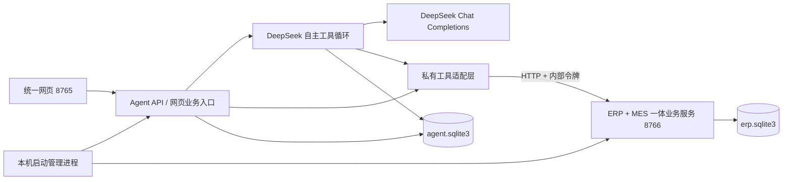

# 已实现的 Demo 架构

本文件描述当前代码，早期设计文档仅作参考。为保证本地一键运行，本次使用 FastAPI、原生 DeepSeek 工具循环、SQLite 和无构建网页，未引入参考方案中的 Java 微服务、Deep Agents、PostgreSQL 和容器沙箱。

## 服务边界



Agent 的业务读写走 `app/adapter.py` 的 HTTP 适配层，共享 Python 模型仅作为输入契约。数据库事务、库存、单据状态、排产上限、设备占用校验位于 ERP/MES 的 `app/domain.py`。Agent 的指令和技能不能绕过业务规则写库。

管理进程随机生成内部令牌，通过子进程环境传递，不写入前端或配置文件。服务绑定环回地址。网页现在要求先登录，写操作要求与登录会话绑定的 CSRF 令牌，并校验 Origin/Host。岗位权限同时作用于网页、Agent 工具、私有适配层与业务后端；详细实现见 [登录与岗位权限](登录与岗位权限使用及实现说明.md)。

私有适配器的 HTTP 客户端随 Agent 服务启动和关闭，复用连接，但用户身份始终按单次请求传入并重新校验。经营总览通过一次内部 `/dashboard` 请求，在一份新建的权限数据快照内完成全部指标和表格查询；不跨请求缓存授权或业务数据。性能测量及复现方法见 [总览性能修复](经营总览性能修复说明.md)。

## 数据口径与状态

- `orders`：一单一种产品，数量/已发货为米。`quantity * unit_price` 为订单金额，不代表付款或收入确认。
- `work_orders`：`planned → running → completed`。下达时按目标量领 BOM 原料；报工追加 `production_reports`，合格品入库存。
- `materials` / `products`：实时库存。`stock_movements` 记录期初、领料、采购、生产入库和销售出库。
- `production_reports`：质检随报工记录；良品率为合格米数除以合格与不合格总米数。不合格也消耗原料，可补产；没有独立质检审批和返修仓。
- `purchases`：`ordered → received`，Demo 采用整单到货。
- `machines`：可用/维护；实际占用通过 `running` 工单判定。
- 请求 ID 与内容指纹校验幂等；同 ID 不同内容拒绝，同 ID 同内容返回原结果。
- 事务技能所有步骤、库存流水、审计在同一数据库事务提交。

只读 SQL 使用 `query_only`、SQLite VM authorizer、表/函数白名单、单语句和指令预算。拒绝写入、ATTACH、PRAGMA、扩展加载、内部幂等表与系统元数据。最多500行、行结果约2MB，超限标记 `truncated`；SQLite单条记录上限1MB、输出列上限200，SQL上限12000字符。SQLite先编译查询识别实际引用的授权表，权限快照只加载这些表；未授权字段和客户范围仍在数据进入查询数据库前过滤。

## Agent 执行

1. `POST /api/chat` 保存消息和任务，返回 HTTP 202、会话 ID、任务 ID。
2. 后台任务加载完整会话、启用技能目录、中国时区时间，调用真实模型。
3. 对模型 function calls 逐一校验和执行；业务写入携带本轮及调用 ID 绑定的幂等键。
4. 保存工具参数和结果/错误，回传给模型继续决策；网页轮询事件显示过程。
5. 保存最终答复或明确失败状态。刷新网页可查看完整历史。
6. 异常重启将运行中任务标为 `interrupted`，补全缺失的工具结果消息，提示先查审计核对；不自动重放写操作。

内置工具：`get_catalog`、`query_data`、`list_skills`、`read_skill`、`run_skill`、`create_report`，以及 `create_order`、`plan_order`、`release_work_order`、`report_production`、`create_purchase`、`receive_purchase`、`ship_order`。没有 MCP、Shell、任意网络或任意文件工具。

模型生成报表必须提供 SQL，后端查询并保存真实结果；网页手工绘表可提供行数据。报表保存标题、类型、X/Y/分组字段、说明、SQL、结果快照、来源和时间。切换图形不改原数据，透视表按维度/分组对首个 Y 数值求和。已有报表不随业务自动更新。

## 技能契约

技能来自 `skills/*.json`，网页配置存储在 Agent 数据库并覆盖同 ID 文件默认值。服务端执行时再次校验启用状态。禁用一个技能不等于撤销其底层普通业务命令。

```json
{
  "id": "custom-receipt",
  "name": "我的到货流程",
  "description": "已到货原料的采购与入库",
  "version": "1.0.0",
  "enabled": true,
  "instructions": "仅在用户明确确认到货后使用，先核对原料及单位。",
  "inputs": {
    "material_id": {"type": "string", "required": true},
    "quantity": {"type": "number", "required": true}
  },
  "steps": [
    {"id":"purchase","operation":"create_purchase","params":{"material_id":"$input.material_id","quantity":"$input.quantity"}},
    {"id":"receipt","operation":"receive_purchase","params":{"purchase_id":"$steps.purchase.id"}}
  ]
}
```

输入类型支持 `string / number / integer / boolean`，可配置 `required`、`default`、`description`。最多 20 个输入、12 步；步骤 ID 唯一，只能引用已声明输入或前序步骤，操作必须已注册。`steps: []` 表示分析指南，Agent 读取后自主组合查询和报表工具。

扩展命令时注册 Pydantic 模型与业务实现，Agent 工具定义和网页业务表单从同一注册表派生。适配其他 ERP 时替换 `ERPAdapter` 的映射及内部 HTTP 契约，无需改为 MCP。

## 网页 API

| 路径 | 用途 |
| --- | --- |
| `GET /api/bootstrap` | 浏览器令牌、模型、连接状态、业务表单 Schema |
| `GET /api/health` | 两服务健康检查 |
| `GET /api/dashboard` | 综合看板 |
| `GET /api/catalog` | 数据目录 |
| `POST /api/query` | `{ "sql": "SELECT ..." }` |
| `POST /api/business/{operation}` | `{ "params": {...}, "request_id": "唯一幂等键" }` |
| `POST /api/chat` | `{ "message": "...", "session_id": null }` |
| `GET /api/sessions` | 会话列表 |
| `GET /api/sessions/{id}?before=消息ID` | 最近200条历史消息，可向前翻页；返回 `has_more/before_id` 和最近20个任务 |
| `GET /api/runs/{id}?after=0` | 最多200条增量事件、`has_more`、任务状态和模型用量；完成任务也须排空剩余分页 |
| `GET /api/skills` | 技能完整配置 |
| `PUT /api/skills/{id}` | 校验并保存完整技能 |
| `GET /api/reports` | 报表列表 |
| `POST /api/reports` | 保存 SQL 或手工数据报表 |
| `GET /api/reports/{id}` | 报表及依据 |
| `GET /api/reports/{id}/csv` | CSV，处理公式文本转义 |
| `POST /api/shutdown` | 无在途任务时关闭整个 Demo |

写接口要求 `X-Demo-Token`，由同源 `GET /api/bootstrap` 获取。内部 ERP API 使用不同的 `X-Internal-Token`，路由是 `/health`、`/catalog`、`/commands`、`/query`、`/commands/{operation}`、`/workflow`。

## 验收

`scripts/acceptance.py` 通过 Agent 对话接口调用真实模型，再独立查询实际业务结果。验证图表金额、采购、事务技能、生产/质检/发货/补产、多轮上下文、自定义与禁用技能、8 种报表接口、私有服务认证、完整关闭、重启持久化。原始证据位于 `docs/真实模型业务验收轨迹.json`。

前端按任务约定不做真实浏览器测试。JavaScript 语法、静态资源 HTTP 与后端接口检查已执行，这些不替代真实浏览器视觉和交互回归。

性能资源边界、索引及并发实现见 [性能检查记录](项目性能检查与优化记录.md)。
